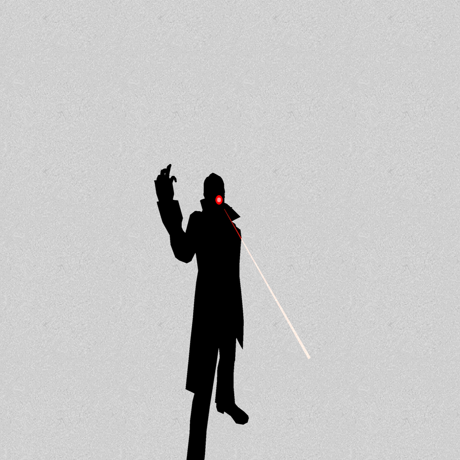
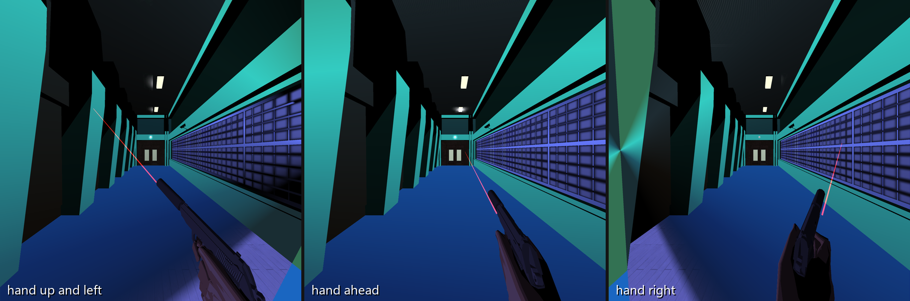
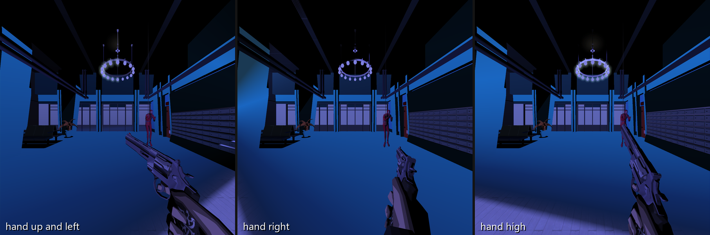

# killer7-vr

A VR mod for the Killer7 PC port (2018/2024 Steam release), through SteamVR: the game in stereo
with head tracking, a HUD panel, the controllers as the gamepad, and first-person aiming where
your right hand holds the character's own gun.

Status: works in a simulated headset; the first real-headset session (2026-10-23) came before
controller aiming and the sharpness fix. v1 targets the first sections of Target 00 (Angel).

## Screenshots

Left-eye images as sent to the headset (simulated headset, 100° view; the HUD is on a separate
panel and not shown).

**The shot that starts a target.** Point the controller at the silhouette: the laser comes out of
the controller and the game's red dot goes where it points. Pull the trigger to fire.

**Garcian, aiming.** Hold the right grip and point. Garcian's hand, sleeve and pistol are where
your hand is, pointing where you point; the world stays put and the game's aim follows the laser.
Three hand directions, same spot:

**Dan, aiming in the lobby.** The same with Dan's revolver (no laser for Dan):

## Install into your game

1. `build.cmd` (VS 18 Build Tools x86, `C:\ninja.exe`) builds `out\XINPUT1_3.dll`.
2. Close the game, then
   `powershell -File tools\install_game.ps1 -Game "<your killer7 folder>"`.
   It adds `XINPUT1_3.dll`, `openvr_api.dll` and a `k7vr\` folder (settings in `k7vr\k7vr.ini`,
   log in `k7vr\k7vr.log`). It changes nothing else: not your saves, not your `killer7.ini`, not
   the game's shader cache.
3. Start SteamVR, then the game as usual. Sit facing forward; hold both stick clicks for a second
   to recentre.

- **Play flat:** hold Shift while the game starts (safe mode), or set `mode=off` in `k7vr\k7vr.ini`.
  If SteamVR can't start, the game also runs flat.
- **Key bindings in VR:** the controllers press keyboard keys, so in VR the game reads its
  settings from `k7vr\killer7.ini`, a copy of your `killer7.ini` (refreshed whenever yours
  changes) with the keyboard bindings the controllers need. Your own file is only read.
- **Uninstall:** `powershell -File tools\install_game.ps1 -Game "<folder>" -Uninstall` (`-Purge`
  also deletes `k7vr\`).

## Controls

The controllers act as the game's own gamepad (its [Pad] bindings, GameCube layout):

| | right hand | left hand |
|---|---|---|
| trigger | fire (pad A) | walk (pad A, hold) |
| grip | aim mode (pad R2, hold), then point the controller | scan (pad L2) |
| A / X | accept (pad A) | map (pad X) |
| B / Y | decline / turn around (pad B) | special (pad Y) |
| stick | right stick | left stick, and the D-pad for menus |
| stick click | reload | game menu / skip (pad Start) |

Both stick clicks held for a second recentre the view. On the silhouette screen that starts a
target, just point the right controller at it.

## Settings

Under `[vr]` in `k7vr\k7vr.ini` (all are listed at the top of `src\vr\vr.h`):

| key | default | what |
|---|---|---|
| `mode` | openvr | `off` plays flat |
| `unit_m` | 0.25 | metres per game unit (world size) |
| `eye_res` / `eye_scale` | auto / 1.0 | eye image size: SteamVR's recommended size times `eye_scale` (try 0.8 if it stutters) |
| `destripe` | 1 | blend the game's alternating 1-pixel columns (fine vertical lines in the headset otherwise) |
| `hand_pitch` | 0 | degrees the aim is tilted up from the controller's pointing axis |
| `hand_offset` | 0,0,0 | grip point in the controller's frame (x right, y up, z back), metres |
| `gun_scale` | 0.6 | gun and hand size |
| `gun_clip` | 2 | how much forearm and sleeve shows behind the hand (game units) |
| `gun_pivot` | auto | the gun's grip in the game's aim view; found per character when aiming starts |
| `no_laser_guns` | 1269 | gun meshes (vertex counts, logged when aiming starts) that get no laser; 1269 = Dan's revolver |
| `aim_depth` | 1 | aim where the controller's ray meets the scene, so shots land where you point at any range (0 = at `aim_converge_m`) |
| `aim_converge_m` | 10 | distance along the ray aimed at when the hit isn't known (ray out of view, `aim_depth=0`) |
| `laser_m` | 30 | laser length (0 = no laser) |
| `aim_hud_mask` | 0.6 | width of the HUD's centre band hidden in aim mode (the game's crosshair) |
| `aim_pitch_limit` | 80 | the game's aim pitch limit, degrees (the game allows 36) |
| `texgen_ref` | 1 | in aim mode, the game's screen-space colour gradients stay as they were when aiming began instead of shifting as the hand turns the game camera (0 = the game's own) |

## Playtest checklist (next headset session)

Setup with the test copy: SteamVR on, `tools\profile.ps1 playtest`, `tools\run.ps1 -Normal`, sit
facing forward. Afterwards `tools\profile.ps1 test` and keep `k7vr\k7vr.log` (it records the
controller types, button codes, the headset's projection and any OpenVR errors).

- [ ] Silhouette screen: does the dot sit where the laser points, and does a shot on the
      silhouette start the target (a miss does nothing, as in the game)?
- [ ] Sharpness: fine vertical lines gone? Sharp enough? (`destripe=0` to compare)
- [ ] Aim mode (first corridor, lobby; aim at walls, doors, lights): does the laser point the way
      you hold the controller? If too high or low, roughly how many degrees (`hand_pitch`)?
- [ ] Is the gun in your hand: position (`hand_offset`), size (`gun_scale`), sleeve length
      (`gun_clip`)? Check both Garcian and Dan.
- [ ] Turning the controller far left/right/up/down: the world must not swing.
- [ ] Fire at something: do hits land on the laser? Does the game's recoil animation feel right
      in the hand?
- [ ] Anything missing from the HUD in aim mode (`aim_hud_mask`)?
- [ ] Menus and title on the big screen; cutscene captions and junction icons on the HUD panel,
      not glued to your face; head turning keeps the scene still (black beyond ~75° off the game
      camera is expected); comfort at camera cuts.

## Development (the test copy)

All automated runs use a **copy** of the game (`C:\Users\Virtual\killer7-vr-game`), never the
Steam install. The copy has `k7vr\SavedGames\` (its own saves and `killer7.ini`; the mod redirects
Saved Games there whenever that folder exists) and `k7vr\shaders\` (shader dumps, written only
when that folder exists).

- `tools\install.ps1` installs into the copy (refuses Steam folders) and seeds its private profile.
- `tools\profile.ps1 test|playtest|sim` switches the copy's `k7vr.ini`: unattended (minimized,
  muted, scripted input, VR off), headset playtest, or the simulated headset.
- `tools\run.ps1` / `-Stop` / `-Normal` start and stop the copy.
- `tools\cmd.ps1 'key SPACE' 'wait 2000' 'shot'` or `tools\cmd.ps1 -File tools\scripts\new_game.txt`
  sends commands; the list is at the top of `src\proxy\control.cpp` (input, screenshots, stereo
  pairs, per-draw captures with `capture N...`, the simulated hand, live aim tuning, memory probes).
- `tools\sheet.ps1 -Out sheet.png -Last 4` tiles the newest screenshots.
- Unit tests: `ctest --test-dir out` (head/aim math, the VR profile's ini rewrite).
- The game addresses the mod relies on are documented where they're used (`aim.cpp`,
  `fov_inflate.cpp`, `hooks_d3d.cpp`, `vr_profile.cpp`).

Output lands in `<game>\k7vr\`: `k7vr.log`, `status.txt`, `shot_*.png`, `capture_*` (per-draw
lists and snapshots), `pair_*` (both eyes as sent to the headset, the raw scene, HUD, screen,
the game's own view).
