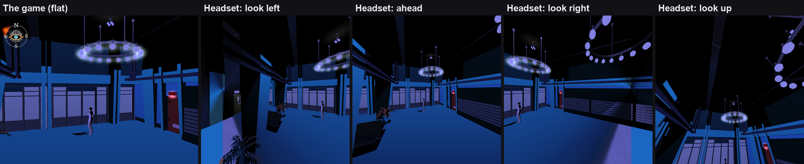
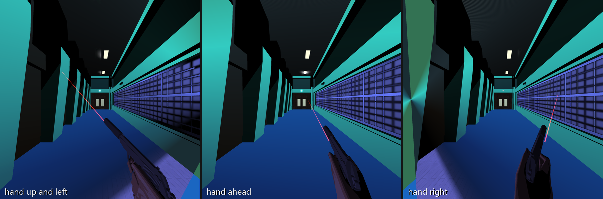
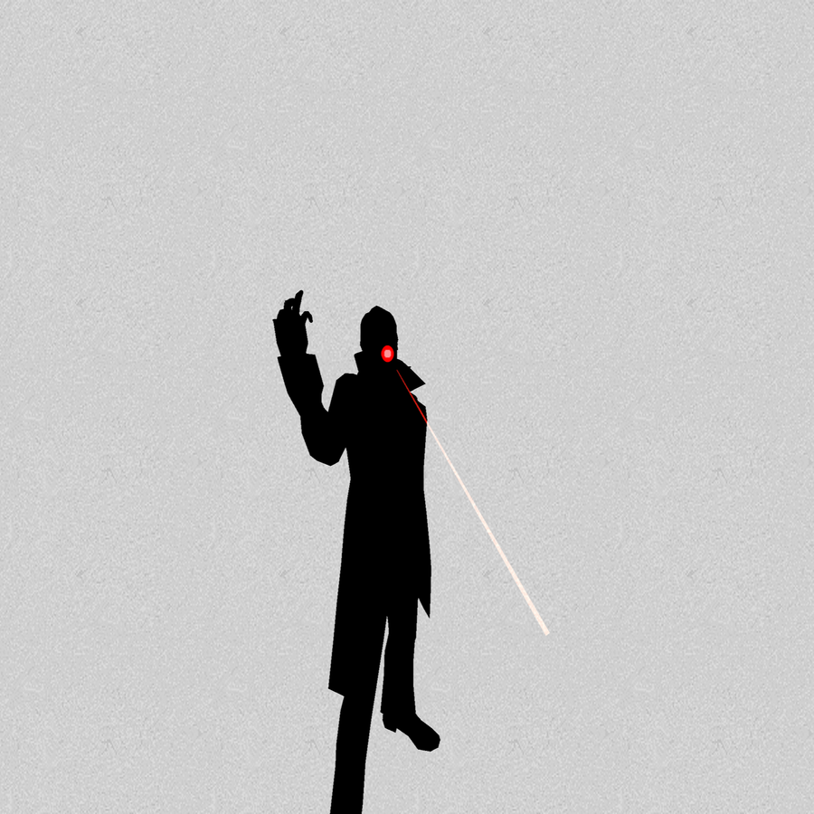

# killer7-vr

A VR mod for the PC version of Killer7 (Steam), through SteamVR. In the headset the 3D world is
drawn in stereo and follows your head, the character's own gun follows your right controller
when you aim, menus and other 2D screens appear on a large virtual screen, and the HUD floats on
a panel in front of you. The controllers act as the game's gamepad, and the game's rumble
(each shot's kick, for one) is felt in them.

This is an early, experimental mod. It has been tested mostly with a simulated headset and in a
few short sessions on a real one, and only through the opening of Target 00 (Angel). Expect
rough edges (see [Known issues](#known-issues)).

## Screenshots

## Requirements

- Killer7 for PC (Steam) on Windows; SteamVR, a headset and two motion controllers.

## Install

1. Download the zip from the [Releases](https://github.com/idio-sync/k7-vr/releases) page.
2. Extract it into the game folder, the one with `Killer7Win.exe` (in Steam: right-click
   Killer7, Manage, Browse local files). That puts `XINPUT1_3.dll` and `openvr_api.dll` next to
   the game, and a `k7vr` folder with the license files.
3. Start the game as usual with the headset connected. VR turns on by itself (SteamVR starts if
   it isn't running); without a headset the game plays flat. Sit facing forward; hold both stick
   clicks for a second to recentre.

- **Play flat:** hold Shift while the game starts, or set `mode=off` in `k7vr\k7vr.ini`.
- **Settings and log:** `k7vr\k7vr.ini` (created on the first start, every setting commented
  out) and `k7vr\k7vr.log`.
- **Key bindings:** in VR the game reads its settings from `k7vr\killer7.ini`, a copy of your
  `killer7.ini` (refreshed whenever yours changes) with the bindings the mod needs. Your own
  file and your saves are untouched.
- **Other mods:** another mod that also uses `XINPUT1_3.dll` can't be installed alongside.
- **Uninstall:** delete `XINPUT1_3.dll`, `openvr_api.dll` and the `k7vr` folder from the game
  folder.

## Controls

The controllers act as the game's own gamepad (its [Pad] bindings, GameCube layout):

| | right hand | left hand |
|---|---|---|
| trigger | fire (pad A) | walk (pad A, hold) |
| grip | aim mode (pad R2, hold), then point the controller | scan (pad L2) |
| A / X | accept (pad A) | map (pad X) |
| B / Y | decline / turn around (pad B) | special (pad Y) |
| stick | right stick | left stick, and the D-pad for menus |
| stick click | reload | game menu / skip (pad Start) |

Both stick clicks held for a second recentre the view. On the silhouette screen that starts a
target, point the right controller at the silhouette and pull the trigger.

## Settings

Under `[vr]` in `k7vr\k7vr.ini`. The ones most worth changing:

| key | default | what |
|---|---|---|
| `mode` | auto | `auto` = VR when a headset is connected, `openvr` = always VR, `off` = play flat |
| `eye_scale` | 1.0 | eye image size as a multiple of SteamVR's recommended size (try 0.8 if it stutters) |
| `unit_m` | 0.25 | metres per game unit (world size) |
| `destripe` | 1 | blend the game's alternating 1-pixel columns (0 shows fine vertical lines) |
| `hand_pitch` | 0 | degrees the aim is tilted up from the controller's pointing axis |
| `hand_offset` | 0,0,0 | grip point in the controller's frame (x right, y up, z back), metres |
| `gun_scale` | 0.6 | gun and hand size |
| `aim_laser` | 0 | 1 draws a laser from the gun in aim mode (the game has none) |
| `rumble` | 1 | strength of the game's rumble on the controllers, 0..1 (0 = off; the game's own Rumble option also applies) |

The full list is in [docs/development.md](docs/development.md#settings).

## Known issues

- Only the opening of Target 00 is checked (up to Harman's Room and the Elevator Hall).
- Killer7's sets are built for fixed cameras. Looking far from where the game's camera points
  (beyond about 75°) shows black, and some sets end just outside the original framing: the top
  of the pigeon memo scene is black, and Harman's Room's spotlights end at a hard edge.
- Subtitles float over the scene without the dark bar behind them.
- Nothing marks where a shot will land while aiming, unless you set `aim_laser=1`.
- At a junction the red tint fills the whole view and the paths' windows and labels sit at
  infinite distance; how that feels in a headset is still unknown.
- HUD parts that point into the scene (the compass, prompts) don't always line up with it, and
  the map's labels are small on the virtual screen.
- Letterboxed cutscenes show a thin line across the view.

## Development

Building, the test harness, the full settings list and the playtest checklist are in
[docs/development.md](docs/development.md). [docs/status.md](docs/status.md) is where the work
stands and what's next.
